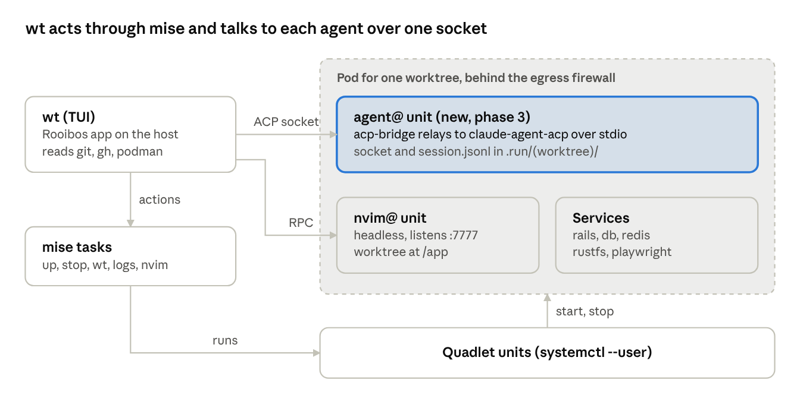

# wt TUI — implementation spec

Oct 20, 2026 · Jeff Bigler

## Overview

`wt` is a terminal dashboard for [rails-dev-podman](https://github.com/jbigler/rails-dev-podman): one screen to see every worktree, its podman services, its gh stack and PR status, and the coding agent working in it, and to act on them without leaving the keyboard. It is built in four phases, starting read-only on top of the existing mise tasks and status files.

The screens are drawn in the design canvas; their sources are in `screens/` next to this file (see `README.md`): dashboard at three widths, agent monitor (cards and list), and agent chat.

Decisions already made:

| Area | Decision |
| --- | --- |
| Language / framework | Ruby with Rooibos (Elm architecture on RatatuiRuby) |
| Agent integration | Agent Client Protocol (ACP): one ACP agent per worktree container; wt renders the session itself |
| Editor | nvim keeps running in its container (`nvim@` unit); wt attaches, opens a new window, or drives it over its socket |
| gh stack | A whole stack lives in one worktree; wt shows HEAD's position and moves up and down the stack |
| Layout | Three width tiers matching niri columns on 2560×1440: ½ (~140 cols), ⅔ (~187), full (~282); full height (~70 rows) |
| Theme | Flexoki light (default) and dark, switchable at runtime |

Out of scope for now: replacing the `wt.localhost` web dashboard, multi-repo support, and agents that are not ACP-capable.

## Where it lives

The TUI goes in a new top-level `tui/` directory of rails-dev-podman and starts with `mise run tui` (alias `w`). It ships with the Quadlet templates and scripts it depends on; it can be extracted as a gem later if it outgrows the wrapper.

- **Ruby** is pinned in `.mise/config.toml` beside the existing tools; `tui/Gemfile` holds `rooibos`, `ratatui_ruby` and test gems. `mise run tui` runs `bundle exec ruby tui/bin/wt` from the workspace root or any worktree.
- **Code is written with Claude Code on the host**, in the wrapper repo (not inside a worktree container): it needs podman, `systemctl --user`, the real worktrees and a terminal to run in.
- **AGENTS.md** gets a short `tui/` section: layout, how to run the tests, and the rule that wt never duplicates logic a mise task or `.scripts/*.sh` already owns.

Proposed layout:

```
tui/
  bin/wt                  # entry point: parse args, boot Rooibos runtime
  lib/wt/
    model/                # Data.define value objects: Worktree, Service, Stack, AgentSession, Plan, ToolCall
    sources/              # read-only adapters: git, systemd, podman, gh, status files, nvim, ACP
    commands/             # Rooibos commands: shell out to mise tasks, ACP requests, nvim remote-send
    update.rb             # message -> (model, commands)
    views/                # dashboard, monitor, chat; layout tiers; widgets (panel, key hints, badges)
    theme.rb              # Flexoki light/dark palettes + accent
    acp/                  # JSON-RPC client over a unix socket
  test/                   # minitest; fixtures captured from real command output
  docs/design/            # this spec, architecture.png, screens/
```

## Architecture

wt is a Rooibos (model–view–update) app: sources turn the outside world into messages, `update` folds them into one immutable model, and the view draws it for the current terminal size. wt reads state directly but changes state only through existing mise tasks, so the CLI and the TUI can't drift apart.

- **Model**: `Data.define` value objects; one `Model` holding worktrees, sessions, UI state (screen, selection, focus, theme, tier).
- **Messages**: `Tick`, `WorktreesLoaded`, `UnitsChanged`, `PrStatus`, `StatusFile`, `AcpUpdate`, `PermissionRequested`, `KeyPressed`, `Resized`, `CommandFinished`.
- **Commands**: long-running readers run as Rooibos async commands that emit messages; short actions shell out and report `CommandFinished` (exit code + stderr shown as a toast).

Data sources by panel:

| Panel | Source | Refresh |
| --- | --- | --- |
| Worktree list | `git worktree list --porcelain` in the base worktree; each worktree's `mise.local.toml` (ports, slug) and the ports registry | on start, on `wt` / `wt:rm`, and on file change |
| Services | `podman ps -a --format json --filter label=…` per project prefix; `systemctl --user show <prefix>-<svc>@<wt>.service` for unit state | 2 s, plus `podman events --format json` stream |
| CPU / mem | `podman stats --no-stream --format json` | 5 s, only for the selected worktree |
| HEAD, ahead/behind, dirty | `git -C <wt> status --porcelain=v2 --branch` | 2 s for visible rows |
| PR + CI | `gh pr view --json number,title,state,isDraft,reviewDecision,statusCheckRollup` | 60 s, and on `p`/push |
| Stack | `gh stack` output for the worktree (parent chain + PR numbers) | 60 s, and after restack |
| Agent state (phase 1) | `.container-config/status/<wt>.json` written by `claude-status-hook.sh` | file watch |
| Agent session (phase 3) | ACP `session/update` notifications over the agent socket | streamed |
| nvim | the nvim server: `nvim --server 127.0.0.1:${NVIM_PORT} --remote-expr` for UI count, buffers, current file | 5 s |
| Logs (full width) | `mise run logs <svc>` / `journalctl --user -fu <unit> -o cat` | streamed |

Actions map to existing tasks: `s` → `mise run up` / `stop`, `r` → `restart <svc>`, `c` → `wt <branch>`, `d` → `wt:rm` (confirm), `L` → `logs`, `n` → `nvim`. Each runs with `cwd` set to the target worktree so the mise env loads. Interactive tasks (nvim attach, `claude`) suspend the TUI, hand over the terminal, and redraw on exit.

Performance budget: no source may block the render loop; every external call runs in a command with a timeout (default 5 s) and a failure shows as a dimmed `?` on that cell, never a crash.

## Agent container and ACP bridge

A new `agent@.container` Quadlet unit runs one ACP agent per worktree behind a unix socket, so sessions outlive wt and need no TTY. That TTY requirement is why `claude@.container` was removed; ACP speaks JSON-RPC over stdio, so the reason no longer applies. `mise run claude` stays as the raw interactive option.



```
 host                               pod for one worktree (behind the egress firewall)
 +--------------+   ACP socket      +------------------------------------------------+
 | wt (TUI)     |------------------>| agent@   acp-bridge <-> claude-agent-acp      |
 | reads git,   |                   |          socket + session.jsonl in .run/<wt>/  |
 | gh, podman   |   nvim RPC (TCP)  |          (new unit, phase 3)                   |
 +--------------+------------------>| nvim@    headless, :7777, worktree at /app    |
        |                           | services rails, db, redis, rustfs, playwright  |
        | actions                   +------------------------------------------------+
        v                                      start, stop ^
 +--------------+   runs   +----------------------------------+
 | mise tasks   |--------->| Quadlet units (systemctl --user) |
 +--------------+          +----------------------------------+
```

wt never changes state itself: actions go through mise tasks to the Quadlet units, while the agent and nvim are reached over their own sockets.

**Unit** (`<prefix>-agent@<wt>.service`), a copy of what `podman-claude.sh` sets up today:

- Same image, network (`<prefix>-<wt>-dev`, alias `agent`), `--userns keep-id`, CPU cap, env files, and every mount (worktree at its host path, `.home/<wt>`, shared claude-memory, `.git` of the base worktree, SSH agent, gitconfig, gem, node and plugin volumes).
- Same egress firewall: the `<prefix>.firewall=agent` annotations, `mode=enforce`, and the hooks dir via `GlobalArgs=--hooks-dir=…`. The unit refuses to start without the hook descriptor, as the script does now.
- `Wants=` rails and playwright for the same reason the script starts them.
- Extra bind mount: `$ROOT/.run/<wt>/` → `/run/agent` (git-ignored), holding the socket and the session log.
- Not started by `mise run up`. It starts on first use from wt (or `mise run agent:up`) and stops with `K` / `mise run agent:stop`.

**Bridge** (`acp-bridge`, a small script baked into the image) is the container's main process:

1. Spawns the agent adapter once and keeps it alive for the container's lifetime. The command comes from `AGENT_CMD`, so the same unit runs `claude-agent-acp` (the `@agentclientprotocol/claude-agent-acp` package `entrypoint-nvim.sh` already installs for CodeCompanion), a Codex adapter, `opencode acp`, or Gemini CLI.
2. Listens on `/run/agent/acp.sock` and relays newline-delimited JSON-RPC between that socket and the adapter's stdio.
3. Allows one client at a time; a second connection gets an error naming the holder.
4. Appends every message to `/run/agent/session.jsonl`, so a reconnecting wt replays the log to rebuild the transcript and plan.
5. While no client is attached, it holds a pending `session/request_permission` and writes `{"state":"permission"}` to the status file, so the dashboard and a desktop notification still show it.

**What wt advertises as an ACP client:** no `fs` and no `terminal` capabilities. The agent then reads, edits and runs commands with its own tools inside the firewalled container, not through wt on the host. wt only renders updates, answers permission requests and sends prompts.

**Permission flow:** the agent sends `session/request_permission` with its options (allow once, allow always, reject). wt shows it inline in the dashboard agent panel, the monitor's Needs attention list and the chat, answered with `1`–`3`. A typed reply rejects and sends the text as the next prompt.

**Status file:** the bridge writes the same `/status/<wt>.json` the Claude hook writes today, extended with `agent`, `plan` (done/total) and `last` fields. The `wt.localhost` web dashboard keeps working unchanged.

## nvim integration

No container changes are needed: `nvim@` already runs `nvim --headless --listen 0.0.0.0:7777`, published on `127.0.0.1:${NVIM_PORT}`, and `mise run nvim` attaches with `--remote-ui`. wt adds three things on top.

| Key | Action | How |
| --- | --- | --- |
| `n` | Attach here | suspend wt, run `mise run nvim` in the worktree, redraw on exit; closing the UI leaves the server running |
| `N` | Attach in a new window | `kitten @ launch --type=os-window --cwd <wt> mise run nvim` (kitty remote control is already used by `nvim@`); fall back to `$TERMINAL -e`, then to `n` |
| `o` / `^o` | Open the selected tool call's file at its line | `nvim --server 127.0.0.1:${NVIM_PORT} --remote-send '<C-\><C-n>:drop /app/<path><CR>:<line><CR>'`; if no UI is attached, also do `N` |
| `d` | Show the edit's diff | `:drop` the file, then `:Gitsigns diffthis` or plain `:diffsplit` against `git show HEAD:<path>` |

**Path mapping:** the agent sees the worktree at its host path (`$ROOT/<wt>`), but nvim mounts it at `/app`. wt rewrites the `$ROOT/<wt>/` prefix of every ACP tool-call location to `/app/` before sending it to nvim. Paths outside the worktree are not opened.

**Status shown in the pod panel:** `--remote-expr` calls for the number of attached UIs (`len(nvim_list_uis())`), buffer count, modified buffers, and current file + line. A port that refuses connections shows `○ stopped`.

**Before stack operations** (`R` restack, `[`/`]` move up or down the stack), wt sends `:wa` if nvim has modified buffers, and refuses the operation with a toast if the write fails.

## Screens, layout tiers and keys

Three screens (`F1`–`F3` or `Tab`), each laid out for the terminal's current column count; `Resized` re-picks the tier on every redraw, so a niri width change reflows at once. Height is never the constraint (~70 rows in every tier). The files in `screens/` are the visual reference for every row below.

| Tier | Columns | Dashboard | Agents | Chat |
| --- | --- | --- | --- | --- |
| Compact | < 100 | one pane at a time: list → ⏎ detail → Esc back | list view only | transcript only; context on `^b` |
| ½ | 100–149 | stacked: list, branch & stack, pod, agent | cards 3 across, max 2 rows, rest as one-line rows | context strip above the input; sidebar on `^b` |
| ⅔ | 150–219 | list full width; branch & stack beside pod; agent panel fills the bottom | cards 4 across, max 2 rows | transcript + 46-col sidebar (worktree, nvim, services, changes) |
| Full | ≥ 220 | list + branch & stack + pod on the left; agent column (112 cols) on the right; service log under the list | cards 6 across | same as ⅔ |

**Worktree list columns** drop or merge as width shrinks: SERVICES becomes one summary mark, CI joins the PR cell, HEAD is middle-truncated, NVIM and LAST are dropped first.

**Agents screen** sorts by urgency (permission → failed → running → done); `^1`–`^9` follow that order. `v` toggles cards / list. Totals in the panel title and the top bar always count every agent, including ones scrolled out of view.

**Theme:** Flexoki light by default, dark via `T` or `WT_THEME=dark`; accent (orange, cyan, purple, blue) via `WT_ACCENT`. Text colours must keep 4.5:1 contrast; states are never told apart by colour alone (each has a glyph: ◆ permission, ✗ failed, ● running, · done, ◐ starting, ○ stopped).

**Global keys** (shown in the bottom bar; `?` lists the rest):

| Key | Action |
| --- | --- |
| `F1`–`F3` `Tab` | Worktrees, Agents, Chat; digits are reserved for answering permissions |
| `↑↓` `⏎` | select, open |
| `a` / `A` | chat with this worktree's agent / new session |
| `n` / `N` / `o` | nvim here / nvim window / open selected tool call |
| `1`–`3` on a permission | allow once / always / reject |
| `s` `r` `L` | start-stop pod, restart service, logs |
| `[` `]` `R` `P` `p` | stack down, up, restack, push stack, open PR |
| `c` `d` | new worktree, remove worktree (confirm) |
| `^]` | leave chat |
| `T` `?` `q` | theme, help, quit |

## Phased plan

Four phases, each shippable on its own and merged as its own PR (or gh stack). Phase 1 changes nothing outside `tui/` and `.mise/`; only phase 3 touches the Quadlet units.

### Phase 1 — read-only dashboard + actions

Scaffold `tui/`, the Rooibos app loop, the theme, and the ⅔ dashboard. Agent state comes from the existing status files.

- [ ] `mise run tui` starts wt from the workspace root and from any worktree; `q` restores the terminal cleanly, including after a crash
- [ ] Worktree list matches `mise run wt:ls`; services match `mise run status` for every worktree
- [ ] PR, CI and stack position appear within 60 s of a push, without blocking input
- [ ] `s`, `r`, `c`, `d`, `L` run the matching mise task in the right worktree; failures show the task's stderr
- [ ] Agent column shows working / waiting / offline from `status/<wt>.json`
- [ ] Light and dark themes; ½ and full tiers reflow correctly when the window is resized
- [ ] Sources are tested against captured command output (fixtures), with no podman needed in tests

### Phase 2 — nvim

- [ ] `n` attaches in place and returns to wt on detach; `N` opens a kitty OS window
- [ ] Pod panel shows nvim UI count, buffers and current file
- [ ] `:wa` runs before restack and stack navigation; a failed write blocks the operation

### Phase 3 — ACP agent

- [ ] `agent@.container` and `acp-bridge` land; `units:install` renders the unit, and it refuses to start without the firewall hook
- [ ] `mise run agent:up` / `agent:stop` work without wt
- [ ] wt connects over the socket, sends prompts, and renders plan, tool calls (kind, status, location) and diffs
- [ ] Permission requests can be answered from the dashboard, monitor and chat; one left unanswered while wt is closed is still there on reconnect
- [ ] Closing and reopening wt rebuilds the transcript from `session.jsonl`
- [ ] `o` opens a tool call's file at the right line in nvim (host path → `/app` mapping)
- [ ] `AGENT_CMD` switches the unit to a second ACP agent with no code change

### Phase 4 — Agents screen and polish

- [ ] Agents screen with urgency sort, two rows of cards plus one-line overflow, and the `v` list view
- [ ] Desktop notification (`notify-send`) on a permission request or failed tool call while wt is not focused
- [ ] Full-width service log panel; compact tier (< 100 cols)
- [ ] Help overlay (`?`) generated from the key map, so it can't drift from the bindings

## Open questions and risks

| Item | Why it matters | Proposed answer |
| --- | --- | --- |
| Rooibos maturity (v0.7, several docs pages are stubs) | Async commands, terminal suspend and resize handling may need workarounds | Spike in the first days of phase 1: suspend/resume for `n`, a streaming command, a resize. If any is blocked, fall back to RatatuiRuby directly with a small hand-written update loop |
| Session resume across adapter restarts | `session.jsonl` replay rebuilds the view, but the agent's own context is lost if the adapter process dies | Use ACP `session/load` where the adapter advertises it; otherwise show "session ended" and offer `A` for a new one |
| Two ACP agents per worktree | CodeCompanion in `nvim@` already runs `claude-agent-acp`; the new `agent@` adds a second, separate one | Accept for now: they are different sessions. Later, CodeCompanion could connect to the bridge socket instead of spawning its own |
| Status hook under ACP | Unverified whether `claude-agent-acp` runs Claude Code's settings hooks | The bridge writes the status file itself, so the hook is no longer required |
| Resource cost | Each worktree already runs rails, postgres, redis, rustfs and often playwright; an always-on agent adds a Node process | `agent@` is opt-in and stops with `K`; the Agents screen shows CPU and memory per agent container |
| gh stack output format | Parsing CLI text is brittle | Prefer a JSON output flag if the extension has one; otherwise derive the chain from each PR's base branch via `gh pr view --json baseRefName` |
| Socket permissions | The bridge socket gives full control of the agent | Socket under the git-ignored `.run/<wt>/`, mode 0600, owned by the host user (keep-id maps uid 1000) |
